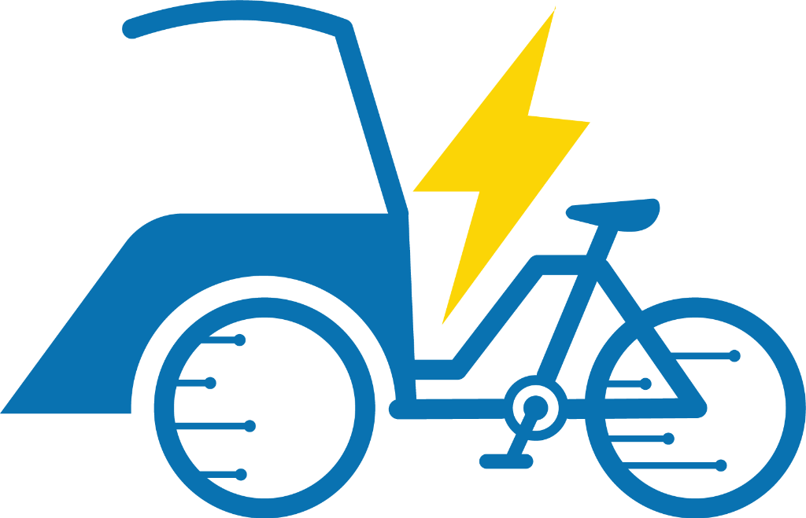

# 🛺 BecaKlik Majalengka — Smart Electric Mobility Platform

<p align="center">
  
</p>

<p align="center">
  <strong>Platform Mobilitas Hijau & Ekosistem Becak Listrik Terpadu untuk Kawasan Wisata & Heritage Majalengka</strong>
</p>

<p align="center">
  
  
  
  
  
  
</p>

> 🌐 **URL Website Live (Production)**: **[https://becaklik.my.id](https://becaklik.my.id)**  
> 📦 **Repositori Kode Publik**: **[https://github.com/EA2511/GTNIC2026_WebDev_KALCER_BecaKlik](https://github.com/EA2511/GTNIC2026_WebDev_KALCER_BecaKlik)**  
> 🏆 **Kompetisi**: GTNIC 2026 — Web Development Competition

---

## 📌 Tentang Proyek

**BecaKlik** adalah platform mobilitas berkelanjutan karya anak bangsa yang mengintegrasikan kearifan lokal becak kayuh Majalengka dengan inovasi armada becak listrik (EV) bertenaga baterai ramah lingkungan. Didesain secara komprehensif untuk mendukung pariwisata heritage, transportasi perkotaan bebas emisi karbon, dan pemberdayaan ekonomi mitra pengemudi lokal.

Platform ini menghubungkan 3 aktor utama secara real-time:

1. **Penumpang (`/pelanggan`)**: Pemesanan rute cepat, peta navigasi interaktif, estimasi tarif transparan, kuitansi digital, serta sistem rating & tip instan.
2. **Mitra Driver (`/driver`)**: Panel operasional pengemudi, sistem giliran antrean pangkalan cerdas, navigasi titik jemput, indikator baterai, dan pelacakan pendapatan harian.
3. **Pusat Operasional & Admin (`/admin`)**: Monitoring live seluruh armada di peta, pemantauan status baterai EV, leaderboard performa mitra, dan kalkulator penghematan emisi CO₂ kota.

---

## 🌟 Fitur Unggulan

### 1. 🚶 Penumpang (Passenger Experience)

- **Peta Interaktif Real-Time**: Integrasi Leaflet OpenStreetMap dengan penentuan titik jemput dan antar presisi di wilayah Majalengka.
- **Rute Populer 1-Klik**: Akses instan rute strategis (Alun-Alun, Pasar Mambo, UNMA, RSUD Cideres, Bunderan Munjul).
- **Tarif Jujur & Promo Sambutan**: Perhitungan jarak akurat berbasis kilometer dengan dukungan kode promo hemat.
- **Kuitansi Digital Resmi (E-Receipt)**: Bukti transaksi elektronik terperinci dengan nomor bukti unik, rincian biaya, dan tanda tangan digital.
- **Ulasan & Penilaian Dinamis**: Sistem ulasan bintang 1-5 dengan kalkulasi waktu relatif real-time (Baru saja, menit lalu, jam lalu, kemarin).

### 2. ⚡ Pengemudi (Driver Workspace)

- **Sistem Antrean Pangkalan Otomatis**: Pengaturan giliran penjemputan adil bagi driver yang berstatus siap.
- **Simulasi Navigasi Perjalanan**: Visualisasi pergerakan becak listrik menyusuri koridor jalan raya KH Abdul Halim hingga titik tujuan.
- **Manajemen Pendapatan & Tip**: Rekapitulasi penghasilan bersih harian dan tip langsung yang diterima dari penumpang.
- **Live Review Ticker**: Ulasan penumpang otomatis diperbarui setiap saat di layar driver tanpa reload.

### 3. 📊 Pusat Kendali Operasional (Admin Operations Hub)

- **Fleet Tracking & Peta Armada**: Visualisasi live posisi seluruh unit armada (BL-001 s.d BL-006) di koridor Majalengka.
- **Health Check Status Baterai EV**: Peringatan dini kapasitas baterai dan kesiapan unit beroperasi.
- **Leaderboard Mitra Driver**: Peringkat performa berdasarkan ketepatan waktu, ulasan pelanggan, dan jumlah tarikan.
- **Mesin Dampak Lingkungan (Eco-Impact Engine)**: Kalkulasi reduksi emisi karbon (kg CO₂) dan pohon yang terselamatkan dari adopsi becak listrik.

---

## 🛠️ Arsitektur & Teknologi

| Komponen            | Teknologi                         | Keterangan                                                       |
| :------------------ | :-------------------------------- | :--------------------------------------------------------------- |
| **Framework**       | Next.js 15 (App Router)           | Arsitektur modern Server & Client Components                     |
| **Bahasa**          | TypeScript 5                      | Type-safety menyeluruh end-to-end                                |
| **Styling**         | Vanilla Modern CSS + Tailwind     | Desain responsif, clean UI/UX, dan micro-interactions            |
| **Peta & GIS**      | Leaflet.js + OpenStreetMap        | Pelacakan geospasial real-time tanpa ketergantungan API berbayar |
| **Database & ORM**  | Prisma ORM (MySQL / SQLite)       | Skema relasional untuk pengguna, pesanan, armada, dan ulasan     |
| **Real-Time Store** | Shared Real-Time In-Memory Engine | Sinkronisasi lintas halaman < 1ms dengan backup disk cache       |
| **Ikon**            | Lucide React                      | Simbol visual modern dan konsisten                               |

---

## 📁 Struktur Direktori Proyek

```text
├── app/                        # Next.js App Router
│   ├── admin/                  # Portal Pusat Operasional & Admin Armada
│   ├── api/                    # RESTful Endpoints (Orders, Drivers, Auth, Simulation)
│   │   ├── admin/              # API Admin (Drivers & Fleet Stats)
│   │   ├── auth/               # Autentikasi Login, Register, Sesi
│   │   ├── driver/             # Status & Navigasi Pengemudi Aktif
│   │   └── orders/             # Pembuatan, Update Status, & Rating Pesanan
│   ├── driver/                 # Panel Aplikasi Mitra Pengemudi Becak
│   ├── login/                  # Portal Masuk Terpadu Multi-Role (1-Click Test)
│   ├── pelanggan/              # Aplikasi Pemesanan Penumpang
│   ├── globals.css             # Tema Desain & Sistem Variabel CSS
│   ├── layout.tsx              # Root Layout & Metadata Platform
│   └── page.tsx                # Halaman Depan & Pengenalan Inovasi
├── components/                 # Reusable UI Components
│   └── map/                    # Leaflet Map Component & Dynamic Loader
├── docs/                       # Dokumentasi Teknis & Laporan Perancangan
│   ├── DATABASE_DESIGN.md      # Perancangan Skema Database
│   ├── TECHNICAL_AUDIT.md      # Audit Kinerja & Keamanan
│   └── FINAL_COMPETITION_REPORT.md # Laporan Akhir Lomba
├── lib/                        # Core Engine & Utilities
│   ├── sharedStore.ts          # State Engine Real-Time Multi-Aktor
│   ├── geo.ts                  # Algoritma Geospasial & Koridor Jalan
│   ├── eco.ts                  # Kalkulator Emisi Hijau & Dampak CO₂
│   ├── auth.ts                 # Utilitas Sesi Enkripsi & Token
│   └── prisma.ts               # Koneksi Prisma Client
├── prisma/                     # Konfigurasi Skema Prisma & Migrasi
├── public/                     # Aset Gambar, Logo, & Manifest PWA
├── run.bat                     # Runner 1-Klik Otomatis (Windows Explorer)
├── run.ps1                     # Runner Terminal PowerShell
└── package.json                # Dependensi & Skrip Proyek
```

---

## ⚙️ Konfigurasi Environment (`.env`)

Sesuai standar keamanan dasar (_security best practice_), file `.env` yang memuat kredensial terlindungi dan **tidak pernah diunggah ke repositori publik** (otomatis diabaikan melalui `.gitignore`).

Untuk keperluan pengujian lokal, sebuah berkas contoh [`.env.example`](.env.example) telah disediakan. Cukup salin berkas tersebut menjadi `.env`:

```bash
# Salin template variabel lingkungan
cp .env.example .env
```

| Variabel         | Deskripsi                                                               | Nilai Default / Contoh                       |
| :--------------- | :---------------------------------------------------------------------- | :------------------------------------------- |
| `DATABASE_URL`   | String koneksi database relasional Prisma (MySQL / SQLite / PostgreSQL) | `mysql://root:@localhost:3306/becak_listrik` |
| `SESSION_SECRET` | Kunci enkripsi sesi otentikasi JWT (minimal 32 karakter unik)           | `abcdefghijklmnopqrstuvwxyzabcdefgh`         |

> 💡 _Catatan Pengujian Live:_ Pada lingkungan deployment Vercel (`https://becaklik.my.id`), seluruh konfigurasi environment telah disuntikkan secara aman melalui dashboard Vercel serta dilengkapi engine _fallback_ cerdas in-memory yang memastikan seluruh fitur, rute, dan simulasi tetap berjalan lancar 100%.

---

## 🚀 Panduan Menjalankan Aplikasi

### Opsi 1: Cara Termudah (Windows Double-Click)

Cukup **klik ganda (double-click)** file berikut di folder proyek:

```text
run.bat
```

Skrip ini akan secara otomatis:

1. Memverifikasi Prisma Client.
2. Membuka browser langsung ke `http://localhost:3000`.
3. Menjalankan server Next.js development.

### Opsi 2: Menggunakan Terminal

```bash
# 1. Pasang dependensi
npm install

# 2. Inisialisasi Prisma Client
npx prisma generate

# 3. Jalankan server pembangunan
npm run dev
```

Buka peramban Anda di **`http://localhost:3000`**.

---

## 🔑 Akses Cepat Akun Demo (1-Click Demo Login)

Pada halaman login live **[https://becaklik.my.id/login](https://becaklik.my.id/login)** (atau `http://localhost:3000/login` pada lingkungan lokal), telah disediakan tombol **Masuk 1-Klik** untuk mempermudah penilaian dewan juri tanpa perlu mengetik manual:

| Peran                | Nama Persona               | Email              | Kata Sandi    | Halaman Utama |
| :------------------- | :------------------------- | :----------------- | :------------ | :------------ |
| **Penumpang**        | Rina Kusuma (Wisatawan)    | `rina@becak.test`  | `password123` | `/pelanggan`  |
| **Mitra Driver**     | Budi Santoso (Unit BL-001) | `budi@becak.test`  | `password123` | `/driver`     |
| **Operations Admin** | Admin Operasional          | `admin@becak.test` | `admin123`    | `/admin`      |

---

<p align="center">
  © 2026 <strong>BecaKlik Team</strong> — Majalengka. All rights reserved.
</p>
