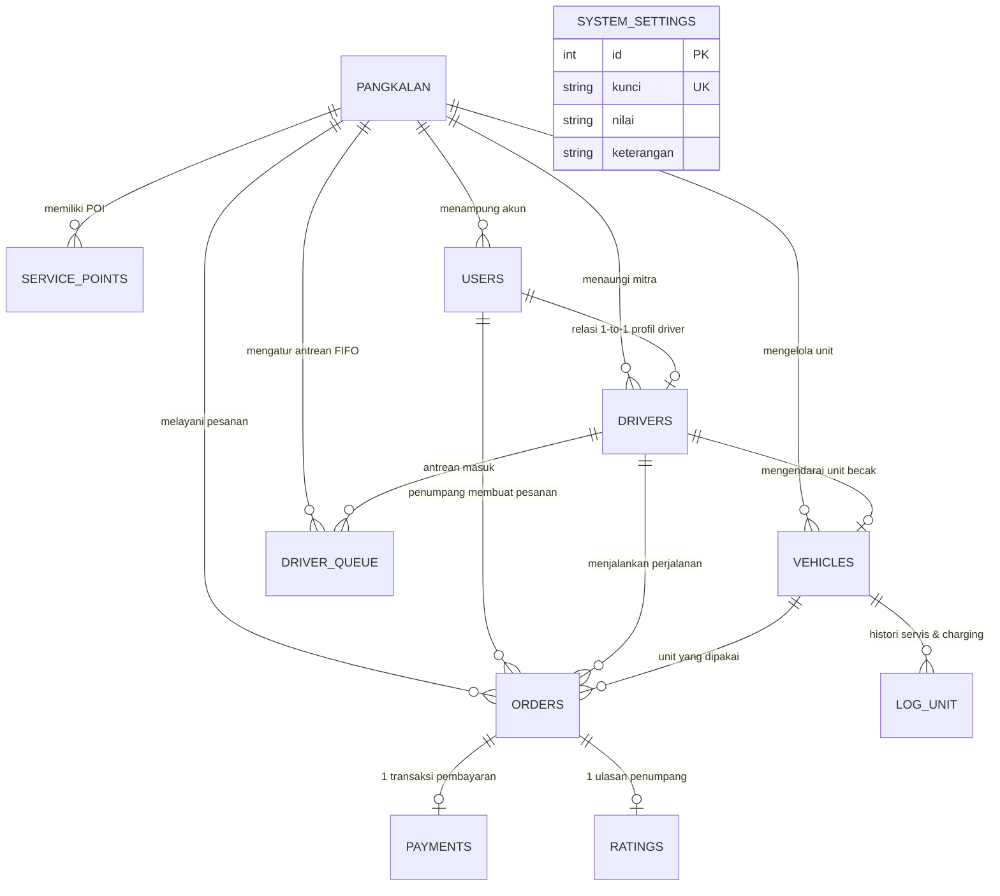

# DATABASE DESIGN — BECAKLIK MAJALENGKA MOBILITY PLATFORM

**Database Engine**: MySQL 8.x / MariaDB (InnoDB Engine)  
**ORM**: Prisma 6  
**Karakteristik**: ACID Compliant, Relational Constraints, High-Performance FIFO Indexing, Geospatial Coordinate Support  

---

## 1. Entity-Relationship Diagram (ERD)

---

## 2. Rincian Kamus Data & Relasi Tabel

### A. Tabel `pangkalan`
Menyimpan identitas usaha/kawasan operasional becak listrik (multi-tenant ready).
- `id` (INT, PK, Auto Increment)
- `nama` (VARCHAR 100): Nama pangkalan operasional (e.g. *Pangkalan Malioboro Heritage*)
- `alamat` (VARCHAR 255): Lokasi fisik kantor/depot pangkalan
- `lat` (FLOAT): Latitude pusat kawasan operasional (-7.7956)
- `lng` (FLOAT): Longitude pusat kawasan operasional (110.3658)
- `radiusKm` (FLOAT): Batas radius radius layanan (default 3.5 km)
- `tarifDasar` (INT): Tarif awal buka pintu (default Rp5.000)
- `tarifPerKm` (INT): Tarif per kilometer perjalanan (default Rp3.000)
- `createdAt` (DATETIME)

### B. Tabel `service_points`
Menyimpan titik penjemputan dan tujuan populer (POI) serta lokasi depot charging.
- `id` (INT, PK, Auto Increment)
- `pangkalanId` (INT, FK -> `pangkalan.id`)
- `nama` (VARCHAR 100): Contoh *Stasiun Tugu*, *Pasar Beringharjo*, *Titik Nol KM*
- `kategori` (VARCHAR 50): STASIUN, WISATA, PASAR, HOTEL, DEPOT
- `alamat` (VARCHAR 255)
- `lat` (FLOAT), `lng` (FLOAT)
- `isDepot` (BOOLEAN): Penanda stasiun pengisian daya / pangkalan induk
- *Indeks*: `@@index([pangkalanId])`

### C. Tabel `users`
Autentikasi seluruh entitas pengguna.
- `id` (INT, PK, Auto Increment)
- `nama` (VARCHAR 100)
- `email` (VARCHAR 120, UNIQUE)
- `noHp` (VARCHAR 20, NULLABLE)
- `passwordHash` (VARCHAR 255): Hash bcrypt
- `role` (ENUM: `ADMIN`, `DRIVER`, `PENUMPANG`)
- `pangkalanId` (INT, FK -> `pangkalan.id`, NULLABLE untuk penumpang umum)
- *Indeks*: `@@index([role])`, `@@index([pangkalanId])`

### D. Tabel `drivers`
Profil operasional pengemudi becak listrik.
- `id` (INT, PK, Auto Increment)
- `userId` (INT, FK -> `users.id`, UNIQUE)
- `pangkalanId` (INT, FK -> `pangkalan.id`)
- `status` (ENUM: `OFFLINE`, `ONLINE`, `ON_TRIP`)
- `currentLat` (FLOAT): Posisi koordinat latitude terkini
- `currentLng` (FLOAT): Posisi koordinat longitude terkini
- `heading` (FLOAT): Arah hadap marker kendaraan dalam derajat (0 - 360°)
- `lastActiveAt` (DATETIME): Timestamp telemetri terakhir
- *Indeks*: `@@index([pangkalanId, status])`

### E. Tabel `vehicles`
Inventaris fisik armada becak listrik ramah lingkungan.
- `id` (INT, PK, Auto Increment)
- `pangkalanId` (INT, FK -> `pangkalan.id`)
- `kodeUnit` (VARCHAR 20): Contoh *BL-001*, *BL-002*
- `status` (ENUM: `TERSEDIA`, `DIPAKAI`, `CHARGING`, `SERVIS`)
- `driverId` (INT, FK -> `drivers.id`, UNIQUE, NULLABLE)
- `batteryPct` (INT): Persentase baterai lithium (0 - 100%)
- *Constraint*: `@@unique([pangkalanId, kodeUnit])`

### F. Tabel `driver_queue`
Mekanisme antrean pengemudi First-In-First-Out (FIFO) yang transparan dan adil bagi UMKM.
- `id` (INT, PK, Auto Increment)
- `pangkalanId` (INT, FK -> `pangkalan.id`)
- `driverId` (INT, FK -> `drivers.id`)
- `status` (ENUM: `MENUNGGU`, `DILAYANI`, `SELESAI`, `KELUAR`)
- `joinedAt` (DATETIME): Waktu masuk antrean
- `servedAt` (DATETIME, NULLABLE)
- *Indeks Kritis*: `@@index([pangkalanId, status, joinedAt])` untuk pengambilan driver tercepat `ORDER BY joinedAt ASC`

### G. Tabel `orders`
Transaksi siklus pemesanan perjalanan.
- `id` (INT, PK, Auto Increment)
- `kode` (VARCHAR 30, UNIQUE): Contoh *ORD-20261028-001*
- `pangkalanId` (INT, FK -> `pangkalan.id`)
- `penumpangId` (INT, FK -> `users.id`)
- `driverId` (INT, FK -> `drivers.id`, NULLABLE)
- `vehicleId` (INT, FK -> `vehicles.id`, NULLABLE)
- `jemputAlamat` (VARCHAR 255), `jemputLat` (FLOAT), `jemputLng` (FLOAT)
- `tujuanAlamat` (VARCHAR 255), `tujuanLat` (FLOAT), `tujuanLng` (FLOAT)
- `jarakKm` (DECIMAL 5,2): Jarak tempuh rute jalan
- `durasiMenit` (INT): Estimasi durasi perjalanan
- `tarif` (INT): Nominal rupiah terkunci
- `status` (ENUM: `MENCARI_DRIVER`, `DITERIMA`, `DIJEMPUT`, `BERJALAN`, `SELESAI`, `DIBATALKAN`)
- `routeGeometry` (LONGTEXT): Array JSON waypoints rute `[[lat, lng], ...]`
- `simulationProgress` (FLOAT): Progres 0 - 100%
- `simulationStep` (INT): Posisi indeks waypoint saat simulasi berjalan
- `alasanBatal` (VARCHAR 255, NULLABLE)
- `createdAt`, `acceptedAt`, `completedAt`
- *Indeks*: `@@index([pangkalanId, status, createdAt])`, `@@index([driverId, completedAt])`

### H. Tabel `payments` & `ratings`
- `payments`: Menampung nominal, metode (`TUNAI`, `QRIS`), status (`BELUM_BAYAR`, `LUNAS`), dan `paidAt`.
- `ratings`: Skor 1-5 bintang dan ulasan testimoni penumpang.

### I. Tabel `system_settings`
Menyimpan konfigurasi demo & parameter kalkulasi emisi karbon:
- `eco_factor_motor_ice_g_co2_per_km`: Faktor emisi sepeda motor bensin (~95 gram CO2/km).
- `eco_factor_becak_kwh_per_km`: Konsumsi listrik becak (~0.035 kWh/km).
- `simulation_speed_multiplier`: Pengali kecepatan simulasi rute (1x, 3x, 5x, 10x).

---

## 3. Aturan Integritas & Transaksionalitas

1. **Pencegahan Double Booking**:
   Saat pesanan dialokasikan ke driver, Prisma `$transaction` digunakan untuk secara atomik mengupdate status order menjadi `DITERIMA`, driver menjadi `ON_TRIP`, dan antrean driver menjadi `DILAYANI`.
2. **Kemandirian Riwayat**:
   Foreign key pada pembayaran dan rating mengunci relasi dengan order, sehingga audit keuangan dan rekap performa operasional driver tetap konsisten.
